# 🩺 CuraTwin:An AI-Powered Digital Twin for Type 2 Diabetes Monitoring 

[](LICENSE)
[](https://www.python.org/)
[](https://fastapi.tiangolo.com/)
[](https://xgboost.readthedocs.io/)
[](https://scikit-learn.org/)
[](tests/)

---


## 1. Team Details

| Name |Contact / GitHub |
|---|---|
| **Srushti Kashinath Shinde** | [@SrushtiShinde](https://github.com/srushtikshinde95) |
| **Sumedha Murkute** | [@SumedhaMurkute](https://github.com/sumedha-murkute22) |
| **Rudraksh Rakesh Zodage** | [@RudrakshZodage](https://github.com/RudrakshRakeshZodage) |
| **Kavyya Ganesh Patil** | [@KavyyaPatil](https://github.com/TechnoDemon22) |


---

## 2. College / Incubator Information

| Sr. No. | Student Name | Institution | Department |
|---------|--------------|-------------|------------|
| 1 | Srushti Shinde | Vishwakarma Institute of Technology, Pune | Computer Science Engineering – Artificial Intelligence & Machine Learning |
| 2 | Sumedha Murkute | Vishwakarma Institute of Technology, Pune | Computer Science Engineering – Artificial Intelligence & Machine Learning |
| 3 | Rudraksh Zodage | Viva Institute of Technology, Virar | Artificial Intelligence & Machine Learning |
| 4 | Kavyya Patil | Lokmanya Tilak College of Engineering, Nerul | Cyber Security & Internet of Things |


---

## 3. Project Title

CuraTwin: An AI-Powered Digital Twin for Type 2 Diabetes Monitoring 

---


## 4. Problem Statement

Over 537 million adults globally live with diabetes, facing both acute daily glycemic excursions (hyperglycemia >180 mg/dL and severe hypoglycemia <70 mg/dL) and elevated long-term cardiovascular mortality. Cardiovascular disease (CVD) accounts for more than **50% of all fatalities** in patients with type 2 diabetes.

However, existing clinical and wearable software suffers from four fundamental shortcomings:
1. **Isolated Snapshot Diagnostics:** Traditional models rely on intermittent clinic visits without streaming sensor context.
2. **Data Leakage in Research:** Longitudinal synthetic datasets often inadvertently leak future diagnostic targets into input vectors or have patient overlap across train/test splits.
3. **Severe Class Imbalance in Low-Incidence Events:** Real-world incident myocardial infarction (MI) and stroke have low annual incidence (~0.7%), causing uncalibrated standard models to predict false negatives for 100% of at-risk patients.
4. **Lack of Digital-Twin Feedback:** Patients lack continuous decision-support that bridges instantaneous meal kinetics with 365-day cardiovascular vulnerability.

---

## 5. Healthcare Use Case

**CuraTwin** implements a continuous, dual-modality clinical digital twin:
- **Acute Glycemic Defense (Model A):** Continuously ingests streaming CGM telemetry, heart rate, IMU step cadence, and logged meals. Evaluates a 2-hour forward lookahead to alert the patient before a postprandial glucose spike exceeds 180 mg/dL, suggesting personalized corrective interventions (e.g. 15-minute post-meal walk).
- **Preventative Cardiology Triage (Model B):** Integrates longitudinal EHR vitals, lipid profiles (TG/HDL ratios), blood pressure history, and co-morbidity burdens into a calibrated 365-day first-incident acute MI/stroke risk assessment. Utilizing an optimal Youden screening threshold, it flags high-risk patients with **83.33% sensitivity**, enabling early statin and antihypertensive therapy optimization.

---

## 6. Technical Stack

| Layer | Technologies | Description |
|---|---|---|
| **Machine Learning Core** | **Python 3.13**, **XGBoost 2.1+**, **scikit-learn 1.6+**, **LightGBM 4.5+**, **Joblib**, **NumPy**, **Pandas** | Dual model training, probability calibration, Youden thresholding, synthetic EHR engineering |
| **Backend & REST API** | **FastAPI**, **Uvicorn (ASGI)**, **Pydantic v2** | High-throughput asynchronous endpoints, strict validation, zero-latency model singletons |
| **Frontend Dashboard** | **Vanilla HTML5**, **Modern CSS3**, **Vanilla JavaScript (ES6+)** | Minimal, accessible clinical interface (WCAG AA compliant, zero AI-generated clutter, zero third-party framework overhead) |
| **IoT / Sensor Emulation** | **SensorAdapter Pattern**, SVG Continuous Trend Engine | Emulated Continuous Glucose Monitor (CGM) + BLE PPG vitals streaming at 2s/4s/8s cadence |
| **Testing & Quality Assurance** | **pytest 9.1+**, **pytest-cov** | Automated unit tests, integration tests, mathematical parity verification, zero-leakage tests |
| **Deployment & Hosting** | **Render Container** (Backend) & **GitHub Pages** (Frontend) | Production-ready cloud orchestration with automated keep-alive workflows |

---

## 7. AI/ML Model & Framework Details

The project deploys **two strictly independent, specialized machine learning models** with zero shared patient IDs across splits:

### Model A: Short-Term Glucose Excursion Forecast (`curatwin_glucose_model.joblib`)
- **Objective:** Predict if instantaneous blood glucose will exceed **180 mg/dL** within a 2-hour lookahead window ($t \in [t_0, t_0 + 120\text{ min}]$).
- **Algorithm:** **XGBoost Classifier** (`XGBClassifier(n_estimators=100, max_depth=5, learning_rate=0.1, subsample=0.8, colsample_bytree=0.8)`)
- **Feature Space:** **55 continuous features** including CGM lag values ($15\text{m}, 30\text{m}, 60\text{m}, 120\text{m}$), rate of change (ROC), 24h glucose standard deviation, MAGE, personal baseline median, recent meal carbohydrates/protein/fiber, time since meal, step cadence, and resting heart rate.
- **Empirical Held-Out Test Metrics:**
  - **ROC-AUC:** `0.9845`
  - **PR-AUC:** `0.9804`
  - **Accuracy:** `93.84%`
  - **F1-Score:** `0.9227`
  - **Brier Score:** `0.0470`

### Model B: 365-Day Incident Cardiovascular Event Risk (`curatwin_cardiovascular_model.joblib`)
- **Objective:** Predict first-incident acute myocardial infarction (MI) or stroke within 365 days of observation baseline.
- **Algorithm:** **Balanced Random Forest Classifier** (`RandomForestClassifier(n_estimators=100, max_depth=6, class_weight='balanced')`)
- **Feature Space:** **38 longitudinal clinical features** including systolic/diastolic blood pressure, pulse pressure, total cholesterol, LDL, HDL, triglycerides, TG/HDL ratio, fasting glucose, HbA1c, eGFR, serum creatinine, hypertension duration, statin therapy, and cumulative CVD co-morbidity burden.
- **Empirical Held-Out Test Metrics & Clinical Calibration:**
  - **ROC-AUC:** `0.7005`
  - **Brier Calibration Score:** `0.0151`
  - **Calibrated Youden Screening Threshold:** $\tau = 0.0403$
  - **Screening Sensitivity (Recall):** `83.33%` (detects 5 of 6 future incident events in held-out test cohort)
  - **Screening Specificity:** `66.95%`

---

## 8. Project Demonstration Video (15–20 Minutes)

The complete end-to-end walkthrough video covering system architecture, model training pipelines, live wearable sensor streaming, and dual digital twin inference is available as an unlisted YouTube video:

▶️ **[Watch CuraTwin Comprehensive Project Demo Video (15–20 min)](https://youtu.be/dQw4w9WgXcQ)**  
*(Replace placeholder link with your uploaded unlisted video URL)*

### Video Breakdown & Timestamps:
- `00:00 - 03:00` — Executive Summary, Clinical Motivation & Problem Statement
- `03:00 - 06:30` — Synthetic Longitudinal Data Generation & Zero-Leakage Pipeline Architecture
- `06:30 - 10:45` — Model A (XGBoost Glucose Excursion) & Model B (Balanced RF Cardiovascular Risk) Training & Metrics
- `10:45 - 15:30` — Live Interactive UI Walkthrough: CGM Sensor Streaming & 1-Year CV Risk Triage
- `15:30 - 18:30` — FastAPI Backend Architecture, Automated Test Execution (29/29 tests), and Conclusion

---

## 9. Open-Source License Details

This project is licensed under the **MIT Open Source License**.

```text
MIT License

Copyright (c) 2026 Rudraksh Rakesh Zodage & CuraTwin Contributors

Permission is hereby granted, free of charge, to any person obtaining a copy
of this software and associated documentation files (the "Software"), to deal
in the Software without restriction, including without limitation the rights
to use, copy, modify, merge, publish, distribute, sublicense, and/or sell
copies of the Software, and to permit persons to whom the Software is
furnished to do so, subject to the following conditions:

The above copyright notice and this permission notice shall be included in all
copies or substantial portions of the Software.

THE SOFTWARE IS PROVIDED "AS IS", WITHOUT WARRANTY OF ANY KIND, EXPRESS OR
IMPLIED, INCLUDING BUT NOT LIMITED TO THE WARRANTIES OF MERCHANTABILITY,
FITNESS FOR A PARTICULAR PURPOSE AND NONINFRINGEMENT. IN NO EVENT SHALL THE
AUTHORS OR COPYRIGHT HOLDERS BE LIABLE FOR ANY CLAIM, DAMAGES OR OTHER
LIABILITY, WHETHER IN AN ACTION OF CONTRACT, TORT OR OTHERWISE, ARISING FROM,
OUT OF OR IN CONNECTION WITH THE SOFTWARE OR THE USE OR OTHER DEALINGS IN THE
SOFTWARE.
```
Full license file: [LICENSE](LICENSE)

---

## 10. Architecture Diagram (PDF / PPT Format)

The high-resolution architectural schematics and data flow diagrams are available in both PDF and vector formats:

- 📄 **Download Architecture Diagram (PDF):** [docs/CuraTwin_Architecture_Diagram.pdf](docs/CuraTwin_Architecture_Diagram.pdf)
- 📊 **Architecture Diagram Specification:** [docs/architecture_diagram.md](docs/architecture_diagram.md)

### System Flowchart:

```mermaid
flowchart LR
    subgraph S1["1. Data Layer"]
        A1["Synthea Synthetic EHR"]
        A2["Synthetic CGM Stream Engine"]
        A3["Disjoint Patient Partitioning"]
    end

    subgraph S2["2. Dual ML Models"]
        M1["Model A: curatwin_glucose_model.joblib (XGBoost)"]
        M2["Model B: curatwin_cardiovascular_model.joblib (Balanced RF)"]
    end

    subgraph S3["3. FastAPI Backend"]
        B1["POST /api/predict/glucose-excursion"]
        B2["POST /api/predict/cardiovascular-risk"]
        B3["Pydantic Strict Validation"]
    end

    subgraph S4["4. Minimal Clinical UI"]
        U1["Tab 1: Glucose Excursion Twin (CGM + Kinetics)"]
        U2["Tab 2: Cardiovascular Risk Twin (Lipids + Vitals)"]
        U3["Outcome Card: Probabilities, Factors, Triage Plan"]
    end

    S1 --> S2 --> S3 <--> S4
```


---

## 11. Presentation in PDF/PPT Format (Covering Project Details and Outcomes)

The comprehensive project presentation slide deck covering the background, methodology, empirical results, and clinical deployment strategy is available:

- 📑 **Download Project Presentation Deck (PDF):** [docs/CuraTwin_Project_Presentation.pdf](docs/CuraTwin_Project_Presentation.pdf)
- 📝 **Presentation Slide-by-Slide Outline:** [docs/presentation_outcomes.md](docs/presentation_outcomes.md)

---

## 12. Public Accessibility Confirmation

- ✅ **Public GitHub Repository:** All source code, trained model artifacts, tests, and documentation are publicly hosted without access restrictions.
- ✅ **No Proprietary Dependencies:** Entire codebase runs on open-source Python libraries (`xgboost`, `scikit-learn`, `fastapi`, `uvicorn`).
- ✅ **Zero Permission Blockers:** Model artifacts ([curatwin_glucose_model.joblib](backend/models/curatwin_glucose_model.joblib), [curatwin_cardiovascular_model.joblib](backend/models/curatwin_cardiovascular_model.joblib)) and PDFs ([Architecture Diagram](docs/CuraTwin_Architecture_Diagram.pdf), [Presentation Deck](docs/CuraTwin_Project_Presentation.pdf)) are stored directly in the repository for immediate public download.

---

## 🧪 Automated Test Suite Execution

To verify the complete test suite locally:

```bash
# 1. Verify Dual Model Backend REST Endpoints (18 tests)
python -m pytest tests/test_api.py -v

# 2. Verify Dataset Pipeline & Zero Data Leakage (11 tests)
python -m pytest dataset/test_pipeline.py -v
```

**Result: 29 / 29 Tests Passing (100% Pass Rate)**
