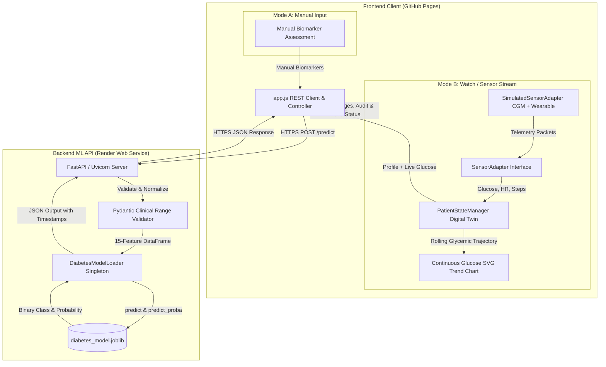

# CuraTwin — AI-Assisted Diabetes Monitoring & Digital Twin Dashboard

**CuraTwin** is a complete, production-ready healthcare digital twin web application that combines **Manual Clinical Biomarker Inputs** with **Real-Time Wearable Sensor Telemetry** (CGM glucose, PPG heart rate, and IMU step tracking) to evaluate diabetes classification from a trained scikit-learn machine learning model deployed on FastAPI and hosted on Render.

---

## 1. System Architecture

CuraTwin decouples client-side presentation and sensor adapters from backend machine learning inference:



---

## 2. Core Capabilities & Dual Modality

### Mode A: Manual Clinical Input
- Enter standard clinical parameters: Gender, Age, Hypertension, Heart disease, Smoking history, BMI (with built-in BMI calculator drawer), HbA1c, and Blood glucose level.
- One-click presets: Specification Sample, Low Risk Case, High Risk Case.
- Full client and server-side validation against physiological limits.

### Mode B: Watch / Sensor Streaming (Digital Twin)
- Modular `SensorAdapter` architecture allowing physical devices (Web Bluetooth / BLE) or realistic simulated telemetry.
- **Biomarker Telemetry:** Continuous Glucose (CGM), Heart Rate (PPG), and Step Activity (IMU).
- **Controls:** Start, Pause, Resume, Stop, Reset, and configurable interval speed (2s, 4s, 8s).
- **Continuous Glycemic Trend Chart:** Real-time SVG rolling trajectory with target glycemic range boundaries (70–140 mg/dL).
- **Digital Twin Integration:** Merges fixed patient clinical baseline (Age, BMI, HbA1c, etc.) with dynamic live glucose streams before calling the model.
- **Provenance & Staleness:** Clearly distinguishes **Measurement Timestamp** from **Prediction Timestamp**, with automatic alerts when newer sensor readings arrive.

---

## 3. Render Deployment Settings

Follow these exact settings when setting up your service on [Render](https://dashboard.render.com):

### Step 1: Push Source Code to GitHub
Ensure all backend files, models, and frontend code are pushed to your repository:
```bash
git add .
git commit -m "feat: complete CuraTwin full-stack application with sensor streaming"
git push origin main
```

### Step 2: Create Web Service on Render
1. Log in to [dashboard.render.com](https://dashboard.render.com).
2. Click **New +** $\rightarrow$ **Web Service**.
3. Select **Build and deploy from a Git repository** and connect your `CuraTwin` repo.
4. Fill in the exact configuration values below:

| Setting Field | Exact Value to Enter | Notes |
|---|---|---|
| **Name** | `curatwin-backend` | Or any unique name you prefer |
| **Region** | `Oregon (US West)` | Or Frankfurt / Singapore |
| **Branch** | `main` | Production branch |
| **Root Directory** | `backend` | ⚠️ **Crucial:** Tells Render to run inside `backend/` |
| **Runtime** | `Python 3` | Standard Python runtime |
| **Build Command** | `pip install --upgrade pip && pip install -r requirements.txt` | Installs pinned FastAPI & scikit-learn packages |
| **Start Command** | `uvicorn main:app --host 0.0.0.0 --port $PORT` | Starts the production server |
| **Instance Type** | `Free` | Free tier supported |

### Step 3: Add Environment Variables
Under **Environment Variables**, add:
- `PYTHON_VERSION`: `3.11.9`
- `ALLOWED_ORIGINS`: `https://rudrakshrakeshzodage.github.io,http://localhost:5500,http://localhost:3000`

### Step 4: Health Check Path
- Under **Advanced**, set **Health Check Path** to `/health`.
- Click **Create Web Service**.

### Step 5: Verify Deployment
Once deployed, verify:
`https://<your-service-name>.onrender.com/health`
Expected JSON output:
```json
{
  "status": "healthy",
  "model_loaded": true,
  "model_version": "1.0",
  "estimator": "LogisticRegression",
  "feature_count": 15
}
```

---

## 4. GitHub Pages Frontend Deployment

1. Open `frontend/app.js` and set your live Render URL on line 18:
   ```javascript
   const API_BASE_URL = "https://<your-service-name>.onrender.com";
   ```
2. Push changes:
   ```bash
   git add frontend/app.js
   git commit -m "chore: configure production Render API URL"
   git push origin main
   ```
3. In your GitHub repository:
   - Go to **Settings** $\rightarrow$ **Pages**.
   - Under **Build and deployment**:
     - Source: **Deploy from a branch**
     - Branch: **`main`**
     - Folder: **`/frontend`**
   - Click **Save**.
4. Open your live dashboard at `https://rudrakshrakeshzodage.github.io/CuraTwin/`.

---

## 5. Local Setup & Testing

### Run Backend:
```bash
python -m venv venv
venv\Scripts\activate
pip install -r backend/requirements.txt
python -m uvicorn main:app --app-dir backend --host 127.0.0.1 --port 8000 --reload
```

### Run Frontend:
```bash
python -m http.server 5500 --directory frontend
```
Navigate to `http://localhost:5500`.

### Run Automated Tests:
```bash
python -m pytest tests/test_api.py -v
```
All 14 automated tests cover model validation, categorical encoding, sensor streaming payload ingestion, and mathematical parity.
