# 🩺 CuraTwin:An AI-Powered Digital Twin for Type 2 Diabetes Monitoring 

[](LICENSE)
[](https://www.python.org/)
[](https://fastapi.tiangolo.com/)
[](https://xgboost.readthedocs.io/)
[](https://scikit-learn.org/)
[](tests/)

---


## 1. Team Details

| Name |Contact / GitHub |
|---|---|
| **Srushti Kashinath Shinde** | [@SrushtiShinde](https://github.com/srushtikshinde95) |
| **Sumedha Murkute** | [@SumedhaMurkute](https://github.com/sumedha-murkute22) |
| **Rudraksh Rakesh Zodage** | [@RudrakshZodage](https://github.com/RudrakshRakeshZodage) |
| **Kavyya Ganesh Patil** | [@KavyyaPatil](https://github.com/TechnoDemon22) |


---

## 2. College / Incubator Information

| Sr. No. | Student Name | Institution | Department |
|---------|--------------|-------------|------------|
| 1 | Srushti Shinde | Vishwakarma Institute of Technology, Pune | Computer Science Engineering – Artificial Intelligence & Machine Learning |
| 2 | Sumedha Murkute | Vishwakarma Institute of Technology, Pune | Computer Science Engineering – Artificial Intelligence & Machine Learning |
| 3 | Rudraksh Zodage | Viva Institute of Technology, Virar | Artificial Intelligence & Machine Learning |
| 4 | Kavyya Patil | Lokmanya Tilak College of Engineering, Nerul | Cyber Security & Internet of Things |


---

## 3. Project Title

CuraTwin: An AI-Powered Digital Twin for Type 2 Diabetes Monitoring 

---


## 4. Problem Statement

Type 2 Diabetes Mellitus (T2DM) is a chronic metabolic disorder that requires continuous monitoring and effective management to reduce the risk of complications. One of the key challenges in diabetes management is identifying potentially harmful fluctuations in blood glucose levels, particularly hyperglycemia, before they progress into more serious health concerns.

Conventional diabetes management often relies on periodic clinical assessments, laboratory measurements such as HbA1c, and individual glucose readings. Although these measurements provide valuable information about a patient's health, they may not fully capture the dynamic relationship between glucose fluctuations, physical activity, sleep patterns, heart rate, medication adherence, and other factors that influence an individual's glycemic state.

The challenge is to develop a personalized, data-driven system that integrates historical Electronic Health Record (EHR) information with dynamic physiological data to identify patterns associated with elevated blood glucose and estimate the risk of a future hyperglycemic event.

CuraTwin addresses this challenge by developing a proof-of-concept Digital Twin for Type 2 Diabetes that combines historical clinical information with simulated or available wearable telemetry to represent a patient's evolving health state and support hyperglycemia risk assessment.

The system aims to demonstrate how synthetic patient records, physiological time-series data, machine learning, and interactive visualization can be integrated into a unified framework for proactive diabetes monitoring.

The prototype uses a Kaggle-sourced diabetes dataset for the documented diabetes classification component and Synthea-generated synthetic patient records to support the EHR integration workflow. Dynamic physiological measurements can be incorporated through simulated or suitable open-source telemetry data.

---

## 5. Healthcare Use Case

CuraTwin focuses on identifying and assessing the risk of hyperglycemia in individuals with Type 2 Diabetes by integrating historical clinical information with changing physiological measurements.

The proposed system combines two complementary data streams:

A. Static and Historical Data — Electronic Health Records

Historical patient information may include:

Demographic information, including age and gender.
Diabetes history and previous diagnoses.
Laboratory indicators such as HbA1c and blood glucose measurements, where available.
Relevant medical history and comorbidities.
Medication and treatment history, where available.

Synthea is used to generate synthetic patient records for demonstrating the EHR component without relying on identifiable real-patient information.

B. Dynamic Data — Wearables and Medical IoT

The dynamic data stream may include:

Continuous glucose monitoring (CGM) measurements.
Heart-rate measurements.
Physical activity and step counts.
Sleep duration and patterns.
Meal-related information and medication logs, where available.

These measurements can be simulated or obtained from appropriately licensed open-source datasets. The prototype can use incoming or simulated readings to update the patient's displayed health state over time.

C. Digital Twin and Risk Assessment

The Digital Twin integrates the available historical and dynamic information into a unified patient representation. The dashboard displays relevant clinical indicators, physiological trends, and available model outputs.

The intended predictive task is to estimate whether a patient is at risk of experiencing a predefined hyperglycemic event within a specified future time window.

This future-event prediction requires appropriately labelled time-series data and a model trained and evaluated for that specific task. The existing diabetes classification model alone does not establish the ability to predict future hyperglycemia.

3. Proposed Solution

CuraTwin proposes a modular healthcare Digital Twin framework with the following workflow:

Patient Data Integration: Ingest historical clinical information from structured datasets and synthetic EHR records.
Physiological Telemetry: Incorporate simulated or available wearable and CGM time-series measurements.
Data Processing: Clean, transform, and align the available clinical and physiological features.
Machine Learning: Apply the existing diabetes classification model to its intended classification task and develop or evaluate a separate hyperglycemia prediction model if suitable labelled time-series data are available.
Digital Twin Representation: Maintain a consolidated representation of the patient's recorded clinical information and changing physiological measurements.
Clinician-Oriented Dashboard: Visualize glucose trends, patient history, telemetry, and available prediction results to support clinical review.
4. Expected Outcome

The expected outcome is a working proof of concept demonstrating how historical EHR information and dynamic physiological telemetry can be brought together in a patient-specific Digital Twin.

## Expected Outcomes

The expected outcomes of CuraTwin include:

1. **Integration of Synthetic EHR and Dynamic Physiological Data:** Combine synthetic Electronic Health Record (EHR) data with dynamic physiological measurements from simulated or available wearable telemetry.

2. **Real-Time Health Monitoring and Visualization:** Visualize changing patient health indicators, including glucose levels and other available physiological measurements, through an interactive dashboard.

3. **Machine-Learning-Based Diabetes Classification:** Use the existing machine learning model to classify diabetes status based on its supported input features.

4. **Short-Term Hyperglycemia Risk Prediction:** Establish a pathway toward predicting short-term hyperglycemia risk using a dedicated model trained and evaluated on appropriately labelled time-series data.

5. **Clinician-Oriented Dashboard:** Provide a centralized dashboard for reviewing patient information, historical records, physiological trends, and available machine learning outputs.


CuraTwin is a research and demonstration prototype, not a clinically validated diagnostic or treatment system. Any hyperglycemia risk predictions must be evaluated before being considered suitable for real-world clinical use.

---

## 6. Technical Stack

| Layer | Technologies | Description |
|---|---|---|
| **Machine Learning Core** | **Python 3.13**, **XGBoost 2.1+**, **scikit-learn 1.6+**, **LightGBM 4.5+**, **Joblib**, **NumPy**, **Pandas** | Dual model training, probability calibration, Youden thresholding, synthetic EHR engineering |
| **Backend & REST API** | **FastAPI**, **Uvicorn (ASGI)**, **Pydantic v2** | High-throughput asynchronous endpoints, strict validation, zero-latency model singletons |
| **Frontend Dashboard** | **Vanilla HTML5**, **Modern CSS3**, **Vanilla JavaScript (ES6+)** | Minimal, accessible clinical interface (WCAG AA compliant, zero AI-generated clutter, zero third-party framework overhead) |
| **IoT / Sensor Emulation** | **SensorAdapter Pattern**, SVG Continuous Trend Engine | Emulated Continuous Glucose Monitor (CGM) + BLE PPG vitals streaming at 2s/4s/8s cadence |
| **Testing & Quality Assurance** | **pytest 9.1+**, **pytest-cov** | Automated unit tests, integration tests, mathematical parity verification, zero-leakage tests |
| **Deployment & Hosting** | **Render Container** (Backend) & **GitHub Pages** (Frontend) | Production-ready cloud orchestration with automated keep-alive workflows |

---

## 7. AI/ML Model & Framework Details

The project deploys **two strictly independent, specialized machine learning models** with zero shared patient IDs across splits:

### Model A: Short-Term Glucose Excursion Forecast (`curatwin_glucose_model.joblib`)
- **Objective:** Predict if instantaneous blood glucose will exceed **180 mg/dL** within a 2-hour lookahead window ($t \in [t_0, t_0 + 120\text{ min}]$).
- **Algorithm:** **XGBoost Classifier** (`XGBClassifier(n_estimators=100, max_depth=5, learning_rate=0.1, subsample=0.8, colsample_bytree=0.8)`)
- **Feature Space:** **55 continuous features** including CGM lag values ($15\text{m}, 30\text{m}, 60\text{m}, 120\text{m}$), rate of change (ROC), 24h glucose standard deviation, MAGE, personal baseline median, recent meal carbohydrates/protein/fiber, time since meal, step cadence, and resting heart rate.
- **Empirical Held-Out Test Metrics:**
  - **ROC-AUC:** `0.9845`
  - **PR-AUC:** `0.9804`
  - **Accuracy:** `93.84%`
  - **F1-Score:** `0.9227`
  - **Brier Score:** `0.0470`

### Model B: 365-Day Incident Cardiovascular Event Risk (`curatwin_cardiovascular_model.joblib`)
- **Objective:** Predict first-incident acute myocardial infarction (MI) or stroke within 365 days of observation baseline.
- **Algorithm:** **Balanced Random Forest Classifier** (`RandomForestClassifier(n_estimators=100, max_depth=6, class_weight='balanced')`)
- **Feature Space:** **38 longitudinal clinical features** including systolic/diastolic blood pressure, pulse pressure, total cholesterol, LDL, HDL, triglycerides, TG/HDL ratio, fasting glucose, HbA1c, eGFR, serum creatinine, hypertension duration, statin therapy, and cumulative CVD co-morbidity burden.
- **Empirical Held-Out Test Metrics & Clinical Calibration:**
  - **ROC-AUC:** `0.7005`
  - **Brier Calibration Score:** `0.0151`
  - **Calibrated Youden Screening Threshold:** $\tau = 0.0403$
  - **Screening Sensitivity (Recall):** `83.33%` (detects 5 of 6 future incident events in held-out test cohort)
  - **Screening Specificity:** `66.95%`

---

## 8. Project Demonstration Video (15–20 Minutes)

The complete end-to-end walkthrough video covering system architecture, model training pipelines, live wearable sensor streaming, and dual digital twin inference is available as an unlisted YouTube video:

▶️ **[Watch CuraTwin Comprehensive Project Demo Video (15–20 min)](https://youtu.be/dQw4w9WgXcQ)**  
*(Replace placeholder link with your uploaded unlisted video URL)*

### Video Breakdown & Timestamps:
- `00:00 - 03:00` — Executive Summary, Clinical Motivation & Problem Statement
- `03:00 - 06:30` — Synthetic Longitudinal Data Generation & Zero-Leakage Pipeline Architecture
- `06:30 - 10:45` — Model A (XGBoost Glucose Excursion) & Model B (Balanced RF Cardiovascular Risk) Training & Metrics
- `10:45 - 15:30` — Live Interactive UI Walkthrough: CGM Sensor Streaming & 1-Year CV Risk Triage
- `15:30 - 18:30` — FastAPI Backend Architecture, Automated Test Execution (29/29 tests), and Conclusion

---

## 9. Open-Source License Details

This project is licensed under the **MIT Open Source License**.

```text
MIT License

Copyright (c) 2026 Rudraksh Rakesh Zodage & CuraTwin Contributors

Permission is hereby granted, free of charge, to any person obtaining a copy
of this software and associated documentation files (the "Software"), to deal
in the Software without restriction, including without limitation the rights
to use, copy, modify, merge, publish, distribute, sublicense, and/or sell
copies of the Software, and to permit persons to whom the Software is
furnished to do so, subject to the following conditions:

The above copyright notice and this permission notice shall be included in all
copies or substantial portions of the Software.

THE SOFTWARE IS PROVIDED "AS IS", WITHOUT WARRANTY OF ANY KIND, EXPRESS OR
IMPLIED, INCLUDING BUT NOT LIMITED TO THE WARRANTIES OF MERCHANTABILITY,
FITNESS FOR A PARTICULAR PURPOSE AND NONINFRINGEMENT. IN NO EVENT SHALL THE
AUTHORS OR COPYRIGHT HOLDERS BE LIABLE FOR ANY CLAIM, DAMAGES OR OTHER
LIABILITY, WHETHER IN AN ACTION OF CONTRACT, TORT OR OTHERWISE, ARISING FROM,
OUT OF OR IN CONNECTION WITH THE SOFTWARE OR THE USE OR OTHER DEALINGS IN THE
SOFTWARE.
```
Full license file: [LICENSE](LICENSE)

---

## 10. Architecture Diagram (PDF / PPT Format)

- 📄 **Architecture Diagram (PDF):** [1_1.pdf](1_1.pdf)


### System Flowchart:

```mermaid
flowchart LR
    subgraph S1["1. Data Layer"]
        A1["Synthea Synthetic EHR"]
        A2["Synthetic CGM Stream Engine"]
        A3["Disjoint Patient Partitioning"]
    end

    subgraph S2["2. Dual ML Models"]
        M1["Model A: curatwin_glucose_model.joblib (XGBoost)"]
        M2["Model B: curatwin_cardiovascular_model.joblib (Balanced RF)"]
    end

    subgraph S3["3. FastAPI Backend"]
        B1["POST /api/predict/glucose-excursion"]
        B2["POST /api/predict/cardiovascular-risk"]
        B3["Pydantic Strict Validation"]
    end

    subgraph S4["4. Minimal Clinical UI"]
        U1["Tab 1: Glucose Excursion Twin (CGM + Kinetics)"]
        U2["Tab 2: Cardiovascular Risk Twin (Lipids + Vitals)"]
        U3["Outcome Card: Probabilities, Factors, Triage Plan"]
    end

    S1 --> S2 --> S3 <--> S4
```


---

## 11. Presentation in PDF/PPT Format (Covering Project Details and Outcomes)

- 📑 **Project Presentation Deck (PDF):** [docs/CuraTwin_Project_Presentation.pdf](docs/CuraTwin_Project_Presentation.pdf)

---

## 12. Public Accessibility Confirmation

- ✅ **Public GitHub Repository:** All source code, trained model artifacts, tests, and documentation are publicly hosted without access restrictions.
- ✅ **No Proprietary Dependencies:** Entire codebase runs on open-source Python libraries (`xgboost`, `scikit-learn`, `fastapi`, `uvicorn`).
- ✅ **Zero Permission Blockers:** Model artifacts ([curatwin_glucose_model.joblib](backend/models/curatwin_glucose_model.joblib), [curatwin_cardiovascular_model.joblib](backend/models/curatwin_cardiovascular_model.joblib)) and PDFs ([Architecture Diagram](docs/CuraTwin_Architecture_Diagram.pdf), [Presentation Deck](docs/CuraTwin_Project_Presentation.pdf)) are stored directly in the repository for immediate public download.

---

## 🧪 Automated Test Suite Execution

To verify the complete test suite locally:

```bash
# 1. Verify Dual Model Backend REST Endpoints (18 tests)
python -m pytest tests/test_api.py -v

# 2. Verify Dataset Pipeline & Zero Data Leakage (11 tests)
python -m pytest dataset/test_pipeline.py -v
```

**Result: 29 / 29 Tests Passing (100% Pass Rate)**
