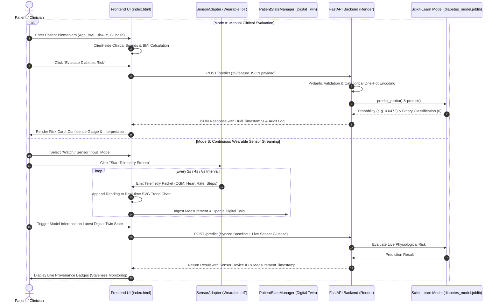
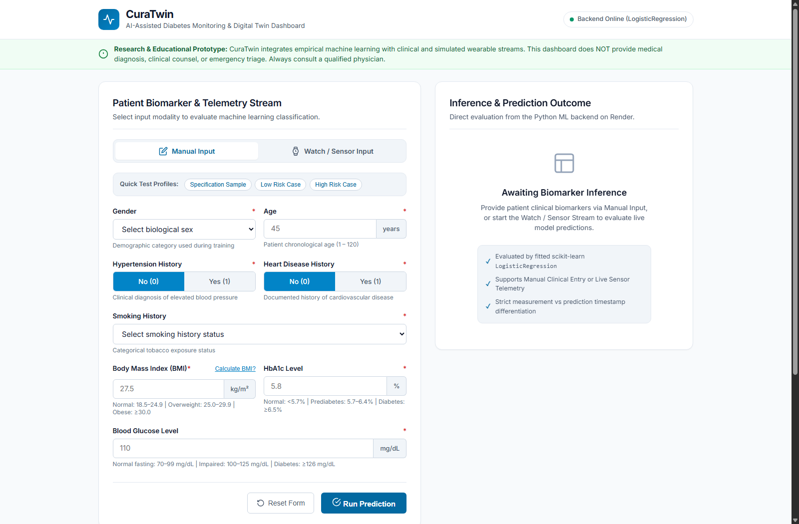

# 🩺 CuraTwin: Real-Time AI Diabetes Digital Twin & Telemetry Dashboard

CuraTwin is a production-grade healthcare digital twin web application that merges **clinical biomarker evaluations** with **real-time wearable sensor streaming** (Continuous Glucose Monitoring CGM, PPG Heart Rate, and IMU step telemetry) for live diabetes risk prediction.

It connects a responsive, glassmorphic client hosted on **GitHub Pages** to a containerized **FastAPI** machine learning backend deployed on **Render**, featuring automated 24/7 keep-alive execution with zero cold starts.

---

<p align="center">
  
  
  
  
  
  
  
  
</p>

---

## 📐 Workflow & Telemetry Sequence Logic



---

## 📸 Application Preview

<p align="center">
  
</p>

---

## 🛠️ The CuraTwin Architecture & Engineering Highlights

### 1. Dual-Modality Digital Twin Architecture
Unlike static clinical risk forms, CuraTwin bridges **two distinct operating modes**:
- **Mode A: Manual Clinical Assessment:** Comprehensive evaluation of primary metabolic biomarkers (Age, Gender, Hypertension, Heart Disease, Smoking History, BMI, HbA1c, and Fasting Glucose).
- **Mode B: Wearable Sensor Streaming:** Continuous live telemetry tracking via an extensible `SensorAdapter` interface.

> [!IMPORTANT]
> **Continuous State Synthesis:** The `PatientStateManager` holds a digital twin of the patient. Fixed baseline biomarkers (Age, BMI, HbA1c) are dynamically merged with fluctuating wearable telemetry (blood glucose, pulse rate, activity steps) in real-time before dispatching inference requests to the cloud.

- **Dynamic SVG Glycemic Trend Chart:** Real-time continuous rolling curve tracking glycemic drift against target therapeutic zones (70–140 mg/dL).
- **Provenance & Staleness Tracking:** Clear visual distinction between **Measurement Timestamp** (when sensor recorded the biomarker) and **Prediction Timestamp** (when inference was performed), with automatic staleness warnings if new sensor data arrives.

---

### 2. Machine Learning Pipeline & Model Training

The core intelligence is driven by a trained supervised machine learning model:

| Property | Details |
|---|---|
| **Training Dataset** | 100,000 healthcare patient records |
| **Target Variable** | `diabetes` (0 = Negative / Non-diabetic, 1 = Positive / Diabetic) |
| **Model Algorithm** | **Logistic Regression** (`LogisticRegression(max_iter=1000, penalty='l2')`) |
| **Artifact Format** | Compressed Scikit-Learn artifact (`diabetes_model.joblib`) |
| **Feature Dimensionality**| Exactly 15 input columns after one-hot categorical expansion |
| **Scaling Strategy** | **Unscaled** — trained directly on raw physiological units (mg/dL, %, kg/m², years) |
| **Inference Output** | Binary classification (`0` or `1`) + Sigmoid probability estimate (0.0 to 1.0) |

#### Exact 15-Feature Order:
```python
[
    'gender_Female', 'gender_Male', 'gender_Other',
    'smoking_history_No Info', 'smoking_history_current', 'smoking_history_ever',
    'smoking_history_former', 'smoking_history_never', 'smoking_history_not current',
    'age', 'hypertension', 'heart_disease', 'bmi', 'HbA1c_level', 'blood_glucose_level'
]
```

---

### 3. 24/7 Cloud Reliability & Zero Cold Starts

Free-tier cloud containers (like Render) automatically spin down after 15 minutes of inactivity. CuraTwin implements an automated keep-alive engine:

- **GitHub Actions Scheduled Cron ([keep_alive.yml](.github/workflows/keep_alive.yml)):** Automatically pings the backend `/health` endpoint every **10 minutes**.
- **Continuous Availability:** Render detects active traffic and never goes to sleep, ensuring instantaneous inference response times 24/7.

---

### 4. Client-Side Security & Immutability

- **Permanently Locked Endpoint:** The backend endpoint is hardcoded as an immutable frozen constant (`Object.freeze("https://curatwin-backend.onrender.com")`).
- **Zero Exposure to End Users:** No configuration modals, input boxes, or settings dialogs exist in the DOM or UI, protecting internal infrastructure while providing a seamless, clean clinical experience.

---

## 💻 Tech Stack

| Layer | Technologies |
|---|---|
| **Frontend** | Vanilla JavaScript (ES6+), Modern CSS3 (Glassmorphism, CSS Custom Properties), HTML5, SVG Trajectory Engine |
| **IoT / Sensor Adapter** | Modular `SensorAdapter` Pattern, `SimulatedSensorAdapter` (CGM, PPG, IMU), `PatientStateManager` |
| **Backend & API** | Python 3.11, FastAPI, Uvicorn (ASGI), Pydantic v2 (Strict clinical range validation) |
| **Machine Learning** | Scikit-Learn, NumPy, Pandas, Joblib |
| **Cloud Hosting** | **GitHub Pages** (Frontend) & **Render** (FastAPI Backend Container) |
| **Automation** | GitHub Actions (24/7 Keep-Alive Workflow & Health Monitoring) |

---

## 🚀 Quickstart & Local Development

### 1. Run FastAPI Backend Locally:
```bash
python -m venv venv
venv\Scripts\activate            # On Windows (or source venv/bin/activate on Linux/Mac)
pip install -r backend/requirements.txt
uvicorn main:app --app-dir backend --host 127.0.0.1 --port 8000 --reload
```

### 2. Run Frontend Dashboard:
```bash
python -m http.server 5500
```
Open `http://localhost:5500` in any web browser.

### 3. Run Automated Tests:
```bash
pytest tests/test_api.py -v
```
All **14 automated tests** validate clinical input range constraints, one-hot vector alignment, mathematical model parity, and sensor telemetry ingestion.

---

## 📄 License
This project is licensed under the [MIT License](LICENSE).
