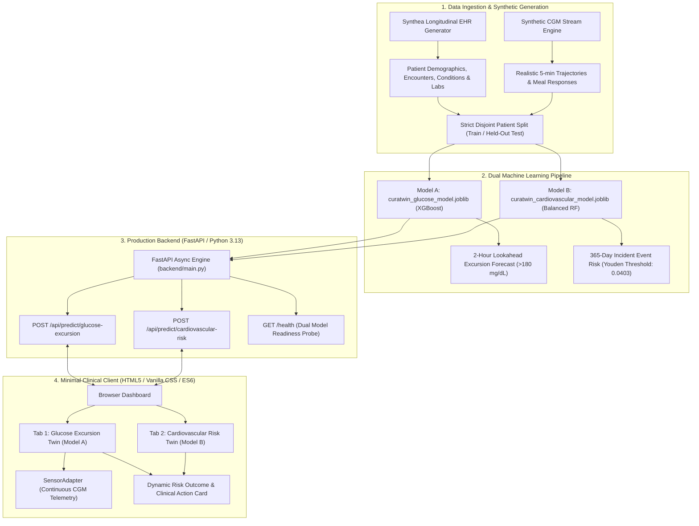

# CuraTwin Architecture Diagram Specifications

This document outlines the detailed system architecture, component breakdown, and communication protocols for **CuraTwin**.

A publication-ready vector PDF version of this architecture diagram is available at:
**[docs/CuraTwin_Architecture_Diagram.pdf](CuraTwin_Architecture_Diagram.pdf)**

---

## 1. High-Level Architectural Flow



---

## 2. Component Directory Structure

```text
CuraTwin/
├── backend/
│   ├── main.py                  # FastAPI server & route handlers
│   ├── model_loader.py          # Dual model loaders & matrix builders
│   ├── schemas.py               # Pydantic v2 validation contracts
│   ├── requirements.txt         # Dependencies (FastAPI, XGBoost, scikit-learn)
│   └── models/
│       ├── curatwin_glucose_model.joblib        # Model A artifact
│       └── curatwin_cardiovascular_model.joblib # Model B artifact
├── dataset/
│   ├── pipeline.py              # Synthetic generation & feature engineering
│   ├── train_models.py          # Benchmark & model training script
│   └── test_pipeline.py         # Pipeline zero-leakage test suite
├── docs/
│   ├── CuraTwin_Architecture_Diagram.pdf # Publication PDF diagram
│   ├── CuraTwin_Project_Presentation.pdf # Presentation slide deck PDF
│   ├── architecture_diagram.md  # Architectural specification
│   └── presentation_outcomes.md # Slide outline & project outcomes
├── tests/
│   └── test_api.py              # Automated 18-test backend validation suite
├── index.html                   # Minimal clinical digital-twin UI
├── style.css                    # Clean, accessible styling
├── app.js                       # Frontend controller & prediction ingestion
├── sensorAdapter.js             # IoT wearable sensor adapter
└── README.md                    # Project documentation & checklist
```
